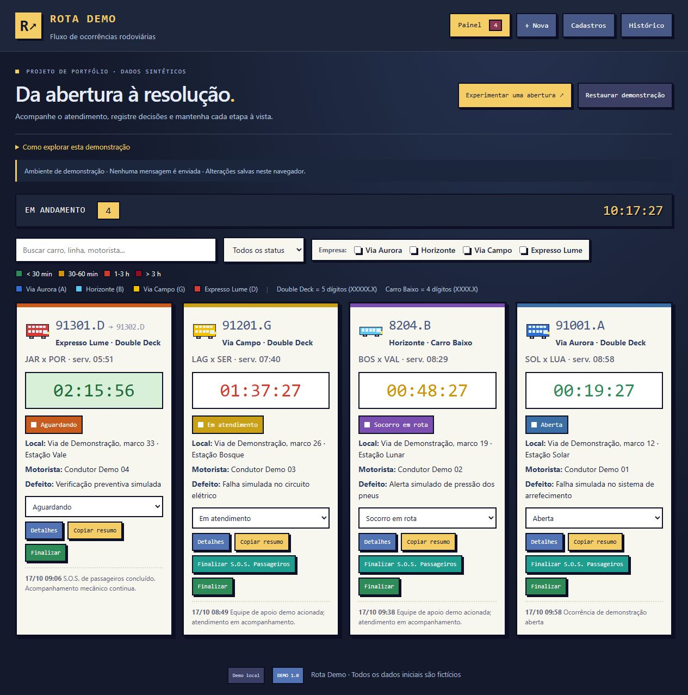

# Fluxo de Ocorrências · Rota Demo

Uma aplicação web para acompanhar ocorrências rodoviárias, do primeiro registro à conclusão do atendimento. O foco é dar visibilidade ao que está acontecendo: veículo envolvido, local, responsável, tempo decorrido e próximos passos.

Esta é uma demonstração de portfólio com identidade própria e uma base totalmente inventada. Funciona no navegador, sem backend, serviços externos ou envio de mensagens.

[Experimentar a demonstração](https://danielmvr.github.io/fluxo-ocorrencias-demo/) · [Estudo de caso](docs/CASE-STUDY.md) · [Verificações](docs/VERIFICACAO.md)



## Executar localmente

Use Node.js 22 com npm. O projeto usa apenas recursos nativos e não exige `npm install`.

```bash
npm start
```

Abra [localhost:4173](http://localhost:4173). Os dados alterados ficam salvos apenas no navegador utilizado.

## Experimente o fluxo

1. Explore o painel, os filtros e as ocorrências já cadastradas.
2. Use **Experimentar uma abertura** para iniciar um novo registro e conferir o preenchimento automático.
3. Registre atualizações na linha do tempo e experimente os indicadores de apoio aos passageiros e atendimento mecânico.
4. Finalize uma ocorrência e reabra o registro para acompanhar a mudança de estado.
5. Use **Restaurar demonstração** para voltar à base inicial. Essa ação substitui as alterações locais da demonstração.

O guia disponível na interface reúne as orientações de uso.

## Recursos implementados

- Painel de ocorrências com filtros, cronômetros e indicadores de urgência.
- Formulário com preenchimento automático a partir dos cadastros.
- Acompanhamento separado dos tempos de socorro aos passageiros e atendimento mecânico.
- Linha do tempo, finalização e reabertura de ocorrências.
- Cadastros de veículos, localidades, apoios, responsáveis e linhas.
- Importação de arquivos CSV, JSON e KML conforme as opções da interface.
- Exportação e backup dos registros da demonstração.
- Restauração da base fictícia e exemplo para explorar o formulário.
- Identidade visual própria, com ônibus em pixel art desenhados em SVG.

## Base fictícia e persistência

Todos os registros iniciais foram criados para esta demonstração, sem derivação de dados operacionais. A base inclui quatro empresas fictícias — Via Aurora, Horizonte, Via Campo e Expresso Lume —, 24 veículos, oito localidades, oito pontos de apoio, cinco responsáveis identificados por função e seis linhas.

Os veículos usam códigos de demonstração e placas como `DEMO-0001`. As localidades seguem nomes do tipo “Estação …”. Os apoios não têm coordenadas e os responsáveis não têm telefones. O cenário inicial contém quatro ocorrências ativas e 12 finalizadas, com horários calculados em relação à abertura da demonstração.

O armazenamento usa `localStorage` na chave exclusiva `rotaDemo.ocorrencias.v1`. Os dados pertencem a esse navegador e à origem em que a página foi aberta; não há sincronização entre dispositivos. As importações também são locais. Use arquivos fictícios ao experimentar o projeto e confira o conteúdo antes de compartilhar um backup exportado.

## Construção

A interface foi construída com HTML, CSS e JavaScript vanilla. Uma camada `Store` concentra o acesso aos dados e à persistência, mantendo as regras da demonstração separadas da apresentação.

O servidor local usa o módulo HTTP nativo do Node.js. Também é possível abrir `index.html` diretamente para explorar a demonstração offline. Para publicação, o build separa a página e os recursos estáticos em `.site/`, diretório usado pelo GitHub Pages.

```bash
npm test         # Verificações automatizadas do projeto
npm run audit    # Auditoria local dos arquivos preparados para publicação
npm run build    # Preparação de index.html e assets/ em .site/
npm run package  # Geração do ZIP com os arquivos permitidos
```

O comando `audit` é uma verificação própria do projeto, não o comando `npm audit` de dependências. O pacote é criado em `release/fluxo-ocorrencias-demo.zip` com uma lista permitida de arquivos. Os diretórios gerados `.site/` e `release/` não entram no pacote de código.

## Escopo e evolução

O projeto demonstra interação, organização de estado e apresentação de um fluxo de atendimento. Autenticação, colaboração entre usuários, backend, integração com mensageria e indicadores de operação real ficam como possíveis evoluções. A demonstração não envia SOS nem aciona serviços de emergência.

Leia o [estudo de caso](docs/CASE-STUDY.md), o [rascunho da publicação no LinkedIn](docs/LINKEDIN.md) e o [roteiro de publicação](docs/PUBLICACAO.md).

## Autoria e licença

Desenvolvido por [Daniel Reis](https://github.com/danielmvr). Este repositório ainda não inclui um arquivo de licença de distribuição.
